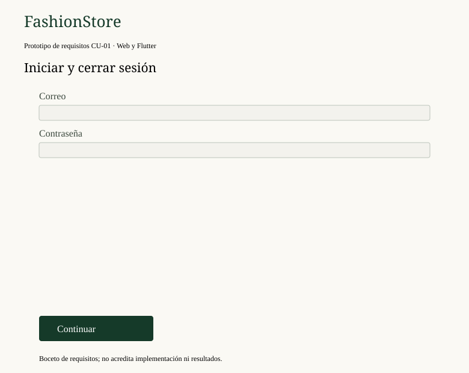
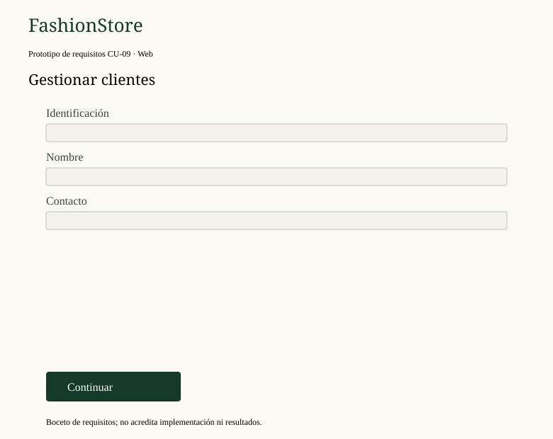
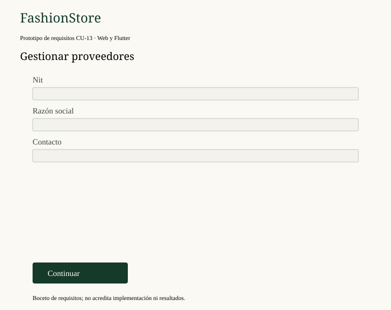
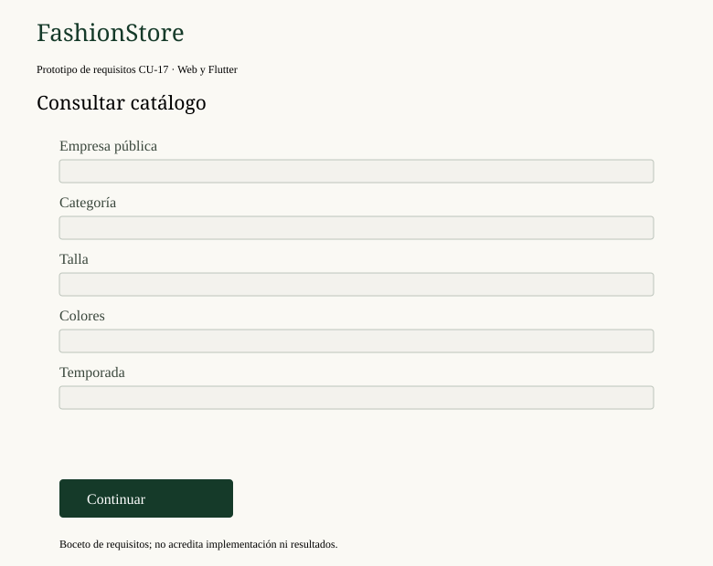
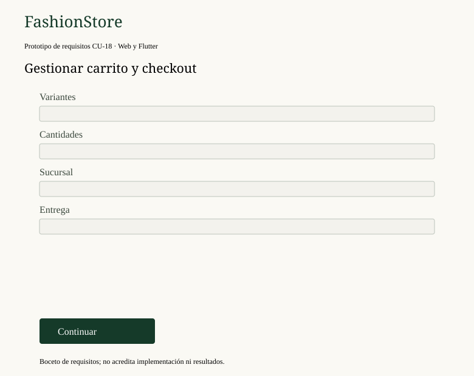
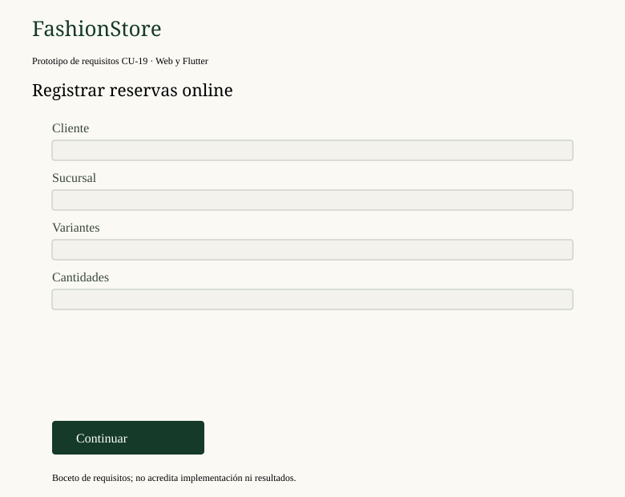
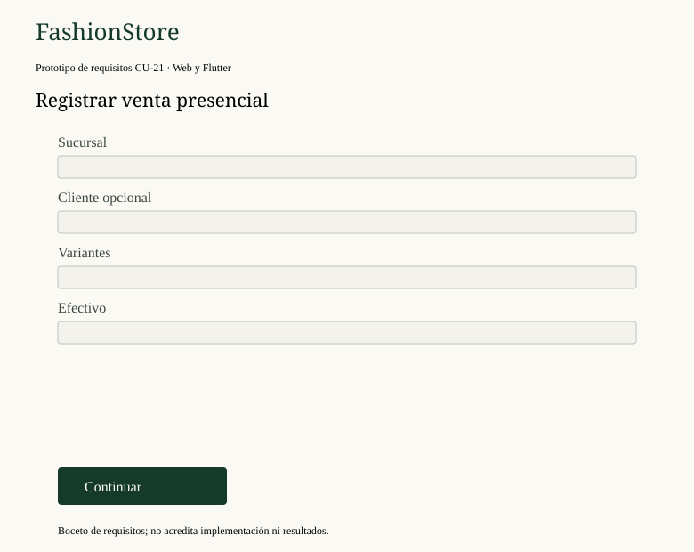
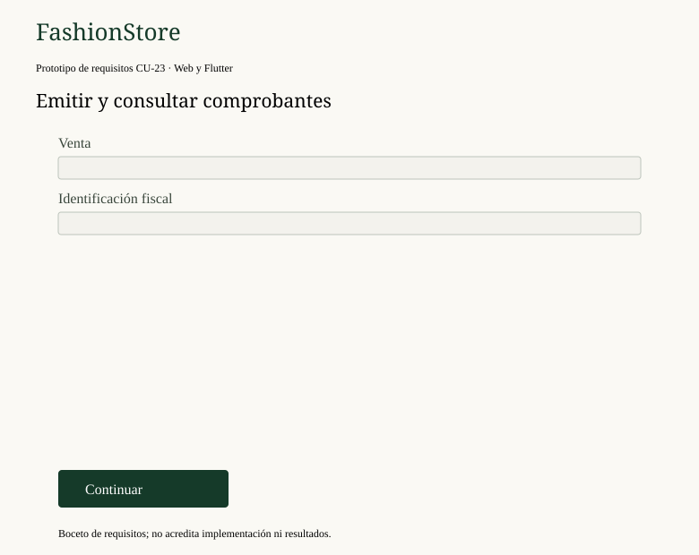
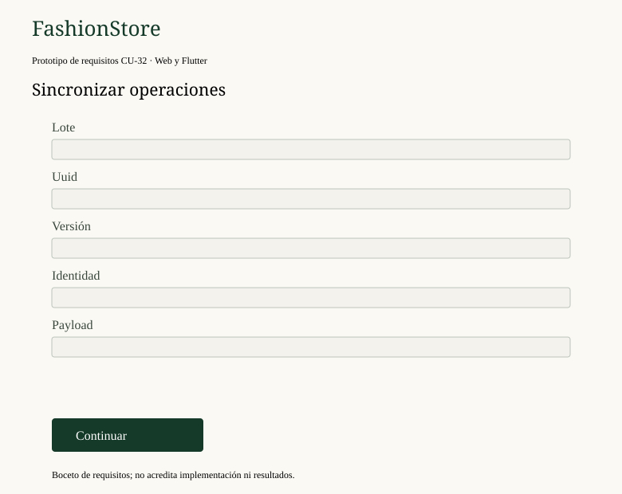
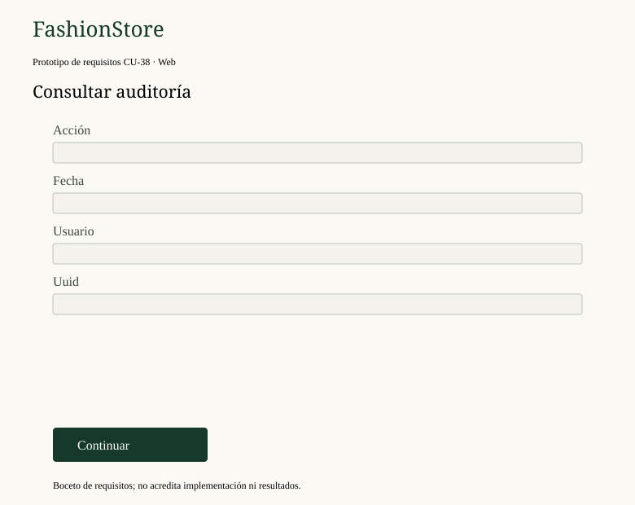

# 2.6. Especificación de casos de uso

La especificación desarrolla los veinte casos de uso presentados en el diagrama UML del apartado 2.5. Cada ficha describe el objetivo, los actores que intervienen, la plataforma, el flujo normal, los flujos alternativos, las postcondiciones, las relaciones con otros casos y el prototipo asociado. Los flujos alternativos se identifican con el número del paso que los origina y una letra, de modo que su lectura no requiera repetir la secuencia completa.

La plataforma **WEB** corresponde a la aplicación Angular; **MÓVIL**, a la aplicación Flutter para Android; **WEB/MÓVIL** indica que el objetivo puede ejecutarse desde ambas. La autenticación se considera precondición de toda operación privada y no se representa como un caso de uso incluido.

Los prototipos incluidos son los bocetos de requisitos del inventario anterior de treinta y ocho casos, reutilizados según la equivalencia documental del apartado 2.5. Son referencias de interfaz y no acreditan la implementación actual.

| **Especificación del Caso de Uso CU01** |  |
|---|---|
| **Caso de Uso** | CU01 - Gestionar acceso y cuenta |
| **Actor Principal** | Usuario de la plataforma: SuperAdministrador SaaS, personal de empresa y Cliente |
| **Plataforma** | WEB/MÓVIL |
| **Descripción** | Registra clientes con identidad global, inicia y cierra sesión mediante correo y contraseña, permite recuperar el acceso y, en el caso del cliente, elegir la tienda después de autenticarse. El servidor devuelve el tipo de cuenta, el rol y el ámbito empresarial; el cierre de sesión revoca el acceso sin eliminar las operaciones pendientes almacenadas en el dispositivo. |
| **Precondiciones** | Conexión disponible para autenticarse o recuperar la contraseña. Cuenta activa y, en el personal, empresa activa con rol y sucursales asignados. El cliente requiere al menos una tienda habilitada para iniciar su operación. |
| **Flujo normal** | 1. El actor abre la aplicación web o móvil y solicita iniciar sesión.
2. Ingresa correo y contraseña, sin indicar empresa.
3. El servidor valida la identidad global y devuelve el tipo de cuenta, el rol, la empresa del personal y las tiendas disponibles.
4. El sistema abre el espacio de plataforma, el panel de la empresa o las tiendas del cliente, según corresponda.
5. El cliente elige la tienda en la que operará; el personal conserva la empresa asignada.
6. El actor cierra sesión y el servidor revoca el token sin eliminar las operaciones pendientes. |
| **Flujos alternativos** | 1a. El interesado no tiene cuenta: se registra como cliente con correo y contraseña, y la cuenta queda habilitada para operar en las tiendas.
1b. El actor olvidó su contraseña: solicita la recuperación, recibe un enlace temporal de un solo uso, define la nueva contraseña y se invalidan las sesiones anteriores.
2a. Credenciales incorrectas o cuenta inexistente: se emite una respuesta uniforme, sin revelar información de la cuenta.
3a. Cuenta o empresa inactiva, o sesión revocada: se impide el acceso.
3b. El personal intenta operar en otra empresa: se deniega.
5a. El cliente no tiene tiendas habilitadas: se informa la situación y no se habilita la operación.
6a. Sin conexión: solo se permite continuar con el modo offline previamente habilitado (CU16). |
| **Postcondiciones** | Sesión activa con el contexto de plataforma, empresa o tienda. Al cerrar, el token queda revocado y las operaciones pendientes del dispositivo se conservan. Cuando se recuperó el acceso, la contraseña queda actualizada y las sesiones anteriores invalidadas. |
| **Relaciones** | No declara «include» ni «extend»: la autenticación es precondición de CU02 a CU20 y habilita el modo offline de CU16. |
| **Prototipo** | 
Bocetos del grupo: CU-01 y CU-02. |

| **Especificación del Caso de Uso CU02** |  |
|---|---|
| **Caso de Uso** | CU02 - Administrar empresas, planes y suscripciones |
| **Actor Principal** | SuperAdministrador SaaS; Administrador de Empresa (consulta de su contrato) |
| **Plataforma** | WEB |
| **Descripción** | Aprovisiona de forma atómica la empresa y su administrador inicial, configura los planes y sus límites, y administra la asignación, renovación o cambio de suscripción comprobando los cupos contratados. El administrador empresarial consulta únicamente el estado y las condiciones del servicio de su propia empresa. |
| **Precondiciones** | Sesión con facultades de plataforma para el alta y la configuración; para la consulta, sesión de Administrador de Empresa. Planes registrados y vigentes. Para el cambio a un plan menor, sucursales activas dentro del límite del plan destino (RN08). |
| **Flujo normal** | 1. El SuperAdministrador accede a la consola de plataforma.
2. Registra la empresa con nombre, identificador público y correo del administrador inicial.
3. Asigna el plan inicial y su vigencia.
4. Configura o actualiza los límites y las capacidades del plan.
5. Asigna, renueva o cambia la suscripción comprobando fechas y cupos.
6. Actualiza las capacidades efectivas y registra la auditoría del cambio.
7. El administrador empresarial consulta el estado y los límites de su contrato. |
| **Flujos alternativos** | 1a. Un usuario de empresa intenta acceder a la consola: se deniega (RN04).
2a. El identificador público ya existe: se rechaza el alta.
2b. Falla la creación del administrador inicial: se revierte el alta completa.
3a. El plan no existe o está inactivo: se rechaza la asignación.
4a. El límite no es positivo o es menor al uso actual: se rechaza.
5a. El cambio a un plan menor deja más sucursales activas que las permitidas: se rechaza (RN08).
5b. La suscripción está vencida: se conserva el historial, se bloquean nuevas operaciones comerciales y se habilita la renovación (RN07).
7a. El administrador empresarial intenta modificar el plan: se deniega. |
| **Postcondiciones** | Empresa y administrador creados atómicamente. Plan y suscripción con vigencias definidas, capacidades efectivas actualizadas y cambios auditados. |
| **Relaciones** | Requiere CU01. Habilita CU03 y CU04 por los cupos y roles, y CU18 cuando el plan contratado es Profesional. |
| **Prototipo** | 
Bocetos del grupo: CU-03, CU-04 y CU-05. |

| **Especificación del Caso de Uso CU03** |  |
|---|---|
| **Caso de Uso** | CU03 - Administrar personal, roles y permisos |
| **Actor Principal** | Administrador de Empresa |
| **Plataforma** | WEB |
| **Descripción** | Mantiene los empleados de la empresa con correo global único, asigna roles y sucursales, y activa, suspende o revoca sus autorizaciones. El sistema impide otorgar privilegios de plataforma y modificar la identidad global de los clientes, y verifica que los permisos efectivos correspondan a la asignación registrada. |
| **Precondiciones** | Sesión de Administrador de Empresa con la empresa activa. Roles y sucursales previamente registrados en el ámbito de la empresa. El correo del empleado no debe pertenecer a otra cuenta. |
| **Flujo normal** | 1. El administrador consulta el personal y los roles de la empresa.
2. Registra el empleado con su correo global.
3. Asigna el rol y las sucursales permitidas.
4. Guarda y activa la autorización.
5. Verifica los permisos efectivos del usuario.
6. Suspende o revoca la autorización cuando corresponda. |
| **Flujos alternativos** | 1a. Personal sin permiso de administración: se deniega.
2a. El correo ya pertenece a otra cuenta: se rechaza.
2b. El correo tiene formato inválido: se rechaza.
3a. El rol o la sucursal pertenecen a otra empresa: se rechaza.
3b. Se intenta asignar privilegios de plataforma o modificar la identidad global de un cliente: se rechaza (RN04).
5a. Los permisos efectivos no coinciden con la asignación: se corrige antes de continuar.
6a. El usuario revocado mantiene una sesión abierta: su siguiente operación se rechaza. |
| **Postcondiciones** | Empleado registrado con rol y sucursales; permisos efectivos comprobados; autorizaciones suspendidas o revocadas cuando corresponde. |
| **Relaciones** | Requiere CU01 y CU04. Condiciona las operaciones de CU10, CU12, CU13 y CU20 según el rol asignado. |
| **Prototipo** | 
Bocetos del grupo: CU-06 y CU-07. |

| **Especificación del Caso de Uso CU04** |  |
|---|---|
| **Caso de Uso** | CU04 - Gestionar ciudades y sucursales |
| **Actor Principal** | Administrador de Empresa |
| **Plataforma** | WEB |
| **Descripción** | Registra ciudades y sucursales con su dirección, responsables y estado, y permite consultarlas, actualizarlas, suspenderlas o reactivarlas. Cada alta o reactivación comprueba la pertenencia a la empresa y el cupo de sucursales activas de la suscripción contratada. |
| **Precondiciones** | Sesión de Administrador de Empresa con la empresa activa. Plan con cupo disponible para una nueva sucursal activa (RN05). Responsables con rol asignado dentro de la empresa. |
| **Flujo normal** | 1. El administrador consulta las ciudades y sucursales de su empresa.
2. Registra la ciudad o selecciona una existente.
3. Ingresa dirección, encargado y estado de la sucursal.
4. Comprueba la pertenencia del encargado y el cupo del plan.
5. Guarda el alta, la actualización, la suspensión o la reactivación.
6. El sistema muestra la estructura operativa actualizada. |
| **Flujos alternativos** | 1a. La sucursal pertenece a otra empresa: no se encuentra.
3a. El encargado es de otra empresa o no tiene rol: se rechaza.
4a. El cupo de sucursales activas está agotado: se rechaza (RN05).
4b. Dos reactivaciones simultáneas superan el límite: la segunda se rechaza.
5a. La sucursal tiene operaciones abiertas: se impide eliminarla y se ofrece suspenderla.
6a. Sin conexión: se conserva la última estructura conocida. |
| **Postcondiciones** | Sucursal registrada o actualizada; cupo consumido o liberado; estructura operativa vigente para las demás operaciones. |
| **Relaciones** | Requiere CU01. Consume el cupo definido en CU02 y delimita CU05, CU08, CU10, CU12 y CU13. |
| **Prototipo** |  |

| **Especificación del Caso de Uso CU05** |  |
|---|---|
| **Caso de Uso** | CU05 - Gestionar fichas de clientes |
| **Actor Principal** | Administrador de Empresa, Encargado de sucursal y Vendedor o cajero; Cliente (consulta de su propia ficha) |
| **Plataforma** | WEB |
| **Descripción** | Crea y mantiene la ficha comercial del cliente dentro de la empresa, con sus datos de contacto e historial de operaciones, evitando duplicados. El cliente consulta su propia información e historial entre tiendas, mientras la identidad global permanece separada del historial comercial de cada empresa. |
| **Precondiciones** | Sesión del personal autorizado o del cliente autenticado para su propia ficha. Empresa activa y cuenta global del cliente registrada. El acceso a fichas ajenas exige pertenencia a la empresa y el permiso correspondiente. |
| **Flujo normal** | 1. El actor busca la ficha por identificación o nombre.
2. Crea o actualiza los datos de contacto permitidos.
3. El sistema valida la identificación única dentro de la empresa.
4. Consulta el historial de operaciones según el rol y la propiedad.
5. Registra la auditoría de la modificación. |
| **Flujos alternativos** | 1a. La ficha pertenece a otra empresa: no se encuentra.
2a. La identificación ya existe en la empresa: se rechaza el duplicado.
2b. Los datos de contacto están incompletos: se rechaza.
4a. El cliente autenticado intenta consultar otra ficha: se deniega.
4b. El personal carece de permiso: se deniega. |
| **Postcondiciones** | Ficha comercial creada o actualizada e historial consultado. La identidad global permanece separada del historial comercial de la empresa. |
| **Relaciones** | Requiere CU01. Toma información de CU11, CU12, CU13 y CU15 para componer el historial. |
| **Prototipo** |  |

| **Especificación del Caso de Uso CU06** |  |
|---|---|
| **Caso de Uso** | CU06 - Administrar catálogo de prendas |
| **Actor Principal** | Administrador de Empresa y Responsable de inventario y compras |
| **Plataforma** | WEB |
| **Descripción** | Organiza categorías, temporadas y colecciones; registra prendas con sus tallas, combinaciones de colores, material y medidas; y configura precios minoristas, mayoristas, umbral de mayoreo y ofertas vigentes. Los elementos pueden publicarse o desactivarse conservando sus relaciones comerciales e históricas. |
| **Precondiciones** | Sesión con permiso de catálogo en la empresa activa. Para registrar prendas y variantes, categorías y temporadas previamente creadas en la misma empresa. Precios definidos conforme a la regla de cálculo del servidor (RN09). |
| **Flujo normal** | 1. El usuario consulta categorías, temporadas y colecciones.
2. Crea o edita la estructura del catálogo.
3. Registra la prenda con atributos, tallas, colores, material y medidas.
4. Define variantes, combinaciones y SKU.
5. Configura precios minorista y mayorista, umbral de mayoreo y ofertas.
6. Publica o desactiva los elementos conservando sus relaciones comerciales. |
| **Flujos alternativos** | 1a. La categoría padre es de otra empresa o genera un ciclo: se rechaza.
2a. Las fechas de la temporada están invertidas: se rechaza.
3a. El SKU ya existe en la empresa: se rechaza.
3b. Faltan atributos o medidas obligatorias: se rechaza.
5a. El precio es negativo o el umbral es inválido: se rechaza.
5b. La oferta está vencida: no se aplica (RN09).
6a. La prenda tiene ventas o reservas: se desactiva, no se elimina. |
| **Postcondiciones** | Catálogo actualizado con precios y ofertas vigentes; prendas publicadas o desactivadas sin perder su historial comercial. |
| **Relaciones** | Requiere CU01. Alimenta CU08, CU09, CU11, CU12 y CU18. |
| **Prototipo** | 
Bocetos del grupo: CU-10, CU-11 y CU-12. |

| **Especificación del Caso de Uso CU07** |  |
|---|---|
| **Caso de Uso** | CU07 - Gestionar proveedores, compras y recepciones |
| **Actor Principal** | Administrador de Empresa y Responsable de inventario y compras |
| **Plataforma** | WEB/MÓVIL |
| **Descripción** | Mantiene la ficha de los proveedores, prepara compras con variantes, cantidades y costos, y confirma la recepción física con sus detalles y entradas de inventario en una sola transacción. La aplicación móvil permite consultar el directorio de proveedores, las compras registradas y el detalle de cada recepción. |
| **Precondiciones** | Sesión con permiso de compras e inventario en la empresa activa. Proveedor registrado, sucursal de recepción autorizada y variantes existentes en el catálogo. Conexión al servidor para confirmar la recepción. |
| **Flujo normal** | 1. El usuario registra o selecciona el proveedor.
2. Prepara la compra con variantes, cantidades y costos.
3. Selecciona la sucursal de recepción.
4. Confirma la recepción física.
5. El sistema registra los detalles, las entradas de inventario y la auditoría en una transacción.
6. Consulta el documento y su detalle. |
| **Flujos alternativos** | 1a. El NIT está repetido o el proveedor es de otra empresa: se rechaza.
2a. La variante pertenece a otra empresa: se rechaza.
2b. La cantidad o el costo no son positivos: se rechaza.
3a. La sucursal no está autorizada: se deniega.
4a. Falla un detalle de la recepción: se revierte la operación completa.
4b. Se reenvía una recepción ya confirmada: no se duplica.
6a. Se repite la consulta del documento: no genera movimientos. |
| **Postcondiciones** | Compra y recepción registradas; existencias incrementadas una sola vez; auditoría y documento disponibles para consulta. |
| **Relaciones** | Requiere CU01. Produce entradas de inventario propias de CU10 dentro de la misma transacción; no declara «include» hacia ese caso (RN14). |
| **Prototipo** | 
Bocetos del grupo: CU-13 y CU-14. |

| **Especificación del Caso de Uso CU08** |  |
|---|---|
| **Caso de Uso** | CU08 - Consultar inventario y disponibilidad |
| **Actor Principal** | Personal de empresa: Administrador de Empresa, Encargado de sucursal, Responsable de inventario y compras y Vendedor o cajero |
| **Plataforma** | WEB/MÓVIL |
| **Descripción** | Obtiene las existencias físicas, las unidades retenidas por reservas vigentes y la disponibilidad resultante por sucursal y variante. El mismo cálculo se reutiliza al confirmar una compra o una venta, y cuando la consulta proviene de datos descargados se identifica la antigüedad de la información. |
| **Precondiciones** | Sesión con sucursal o sucursales asignadas dentro de la empresa activa. Inventario registrado para las variantes consultadas. Para información vigente, conexión con el servidor; en modo local, catálogo descargado y vigencia offline habilitada. |
| **Flujo normal** | 1. El usuario selecciona la empresa y la sucursal autorizada.
2. Consulta las existencias físicas.
3. El sistema obtiene las retenciones vigentes de las reservas.
4. Calcula la disponibilidad de las variantes solicitadas.
5. Presenta las cantidades y la fecha de actualización de la información. |
| **Flujos alternativos** | 1a. La sucursal no está autorizada para el usuario: se deniega.
2a. No existen registros para la variante: se muestra un resultado vacío.
5a. No hay conexión: se muestra la copia local con su antigüedad.
5b. La copia local supera las veinticuatro horas: se advierte y se limita la operación. |
| **Postcondiciones** | Disponibilidad presentada con su fecha de actualización. No se modifican existencias ni retenciones. |
| **Relaciones** | «include» desde CU11 y CU13, que la ejecutan de forma obligatoria antes de confirmar. Es utilizada por CU09, CU12 y CU17. |
| **Prototipo** |  |

| **Especificación del Caso de Uso CU09** |  |
|---|---|
| **Caso de Uso** | CU09 - Explorar catálogo y asistencia de compra |
| **Actor Principal** | Visitante y Cliente; Servicio de inteligencia artificial (vestidor y recomendaciones) |
| **Plataforma** | WEB/MÓVIL |
| **Descripción** | Permite buscar prendas por categoría, temporada, talla, color y precio, consultar sus variantes y disponibilidad, y utilizar opcionalmente el vestidor virtual y las recomendaciones sobre prendas de la tienda elegida. Las prendas seleccionadas pueden derivar en una compra o en una reserva independiente. |
| **Precondiciones** | Tienda pública seleccionada o contexto empresarial autorizado. Catálogo publicado con al menos una prenda activa. Para el vestidor y las recomendaciones, servicio de inteligencia artificial disponible; para operaciones privadas, sesión de cliente. |
| **Flujo normal** | 1. El actor elige la tienda o el contexto empresarial autorizado.
2. Busca prendas y aplica filtros.
3. Consulta variantes y precios aplicables.
4. Consulta la disponibilidad (CU08).
5. Utiliza opcionalmente el vestidor o las recomendaciones.
6. Selecciona prendas para una compra o una reserva. |
| **Flujos alternativos** | 1a. La empresa no existe o está inactiva: no se encuentra.
2a. No hay coincidencias con los filtros: se muestra un resultado vacío.
4a. No hay conexión: se utiliza el catálogo descargado previamente (CU16).
5a. El permiso de cámara se rechaza: se informa y se continúa sin vestidor.
5b. El servicio de inteligencia artificial no responde: se continúa sin recomendaciones.
6a. El visitante intenta una operación privada: se solicita crear cuenta. |
| **Postcondiciones** | Prendas seleccionadas por el actor. No se confirma ninguna transacción comercial. |
| **Relaciones** | «include» hacia CU08. El vestidor y las recomendaciones son opcionales y no condicionan la compra ni la reserva. |
| **Prototipo** | 
Bocetos del grupo: CU-17, CU-26 y CU-27. |

| **Especificación del Caso de Uso CU10** |  |
|---|---|
| **Caso de Uso** | CU10 - Registrar movimientos de inventario |
| **Actor Principal** | Administrador de Empresa, Responsable de inventario y compras y Encargado de sucursal |
| **Plataforma** | WEB/MÓVIL |
| **Descripción** | Registra entradas, salidas, ajustes y transferencias autorizadas con su motivo, cantidades y responsables, aplicando un único efecto sobre las existencias mediante el mecanismo de movimientos del sistema. La confirmación conserva la trazabilidad y revierte el conjunto cuando falla un paso intermedio. |
| **Precondiciones** | Sesión con permiso de inventario en la empresa activa. Sucursales y variantes existentes y autorizadas para el usuario. Existencias suficientes para una salida o transferencia (RN10). Conexión al servidor. |
| **Flujo normal** | 1. El usuario selecciona el tipo de movimiento y la sucursal.
2. Elige las variantes y las cantidades.
3. El sistema valida cantidades, pertenencia y autorización.
4. Controla o bloquea las existencias afectadas.
5. Registra el movimiento y su efecto único sobre el stock.
6. Confirma la trazabilidad y el responsable. |
| **Flujos alternativos** | 1a. La sucursal es ajena a la empresa: se deniega.
3a. La cantidad no es positiva: se rechaza.
3b. La variante pertenece a otra empresa: se rechaza.
4a. El stock es insuficiente: se rechaza sin producir efecto (RN10).
5a. Falla un paso intermedio: se revierte el movimiento.
5b. Se reintenta con el mismo UUID: no se duplica (RN14 y RN18). |
| **Postcondiciones** | Movimiento registrado una sola vez, existencias actualizadas y auditoría con responsable y motivo. |
| **Relaciones** | «include» desde CU11 y CU13. Recibe las entradas de CU07 y las reposiciones de CU15. |
| **Prototipo** |  |

| **Especificación del Caso de Uso CU11** |  |
|---|---|
| **Caso de Uso** | CU11 - Realizar compra y pago en línea |
| **Actor Principal** | Cliente y Pasarela de pagos |
| **Plataforma** | WEB/MÓVIL |
| **Descripción** | Administra el carrito y el checkout con sucursal y forma de entrega, recalcula los importes en el servidor y consulta la disponibilidad antes de confirmar. El pago electrónico se valida con el resultado verificable de la pasarela y, solo entonces, se confirma la venta con su salida única de inventario. Un pago pendiente o abandonado no constituye una venta. |
| **Precondiciones** | Cliente autenticado con tienda seleccionada y suscripción vigente de la empresa. Carrito con al menos un ítem y disponibilidad suficiente (RN10). Pasarela de pagos configurada y conexión al servidor. |
| **Flujo normal** | 1. El cliente prepara el carrito con variantes y cantidades.
2. El servidor recalcula precios y descuentos.
3. El sistema consulta la disponibilidad (CU08).
4. El cliente selecciona sucursal y forma de entrega.
5. Inicia el pago electrónico.
6. El sistema valida el resultado firmado de la pasarela.
7. Confirma la venta y la salida de inventario (CU10) una sola vez.
8. Presenta el resultado y ofrece el comprobante. |
| **Flujos alternativos** | 2a. El precio o el descuento fue alterado: se recalcula (RN09).
3a. El stock es insuficiente: se informa y no se confirma.
4a. El carrito está vacío: no se inicia el checkout.
5a. La pasarela no está disponible: se conserva el pago como pendiente.
6a. La firma es inválida o el importe no coincide: se rechaza (RN13).
6b. El pago es rechazado o expira: se conserva el estado fallido sin confirmar la venta.
6c. El evento se repite: se devuelve la misma confirmación.
7a. Falla un paso intermedio: se revierten la venta y la salida de inventario. |
| **Postcondiciones** | Venta confirmada y pagada; inventario descontado una sola vez; comprobante disponible; carrito cerrado. Si el pago no se confirmó, la venta no existe y el carrito permanece. |
| **Relaciones** | «include» hacia CU08 y CU10. CU14 extiende a este caso en el punto «compra confirmada». |
| **Prototipo** | 
Bocetos del grupo: CU-18 y CU-22. |

| **Especificación del Caso de Uso CU12** |  |
|---|---|
| **Caso de Uso** | CU12 - Gestionar reservas de prendas |
| **Actor Principal** | Cliente; Encargado de sucursal, Vendedor o cajero y Administrador de Empresa |
| **Plataforma** | WEB/MÓVIL |
| **Descripción** | Registra reservas con cliente, sucursal y detalles, retiene la disponibilidad durante veinticuatro horas y permite preparar las prendas, confirmar el pago cuando corresponda, entregar o cancelar. El vencimiento libera la retención sin generar una venta ficticia, y el cliente opera únicamente sobre sus propias reservas. |
| **Precondiciones** | Cliente autenticado o personal con permiso de atención de reservas. Sucursal con existencias disponibles para las variantes solicitadas (RN10 y RN11). Conexión para registrar la reserva central. |
| **Flujo normal** | 1. El actor selecciona cliente, sucursal y prendas.
2. El sistema consulta la disponibilidad (CU08).
3. Registra la reserva con retención de veinticuatro horas.
4. El personal prepara las prendas y confirma el pago cuando corresponde.
5. Se entrega la reserva y se registra la venta asociada.
6. Se cancela o se deja vencer, liberando la retención. |
| **Flujos alternativos** | 2a. El disponible es insuficiente: se rechaza.
3a. Ya existe una reserva para la misma unidad: se rechaza el duplicado.
4a. El pago continúa pendiente: no se entrega.
5a. La reserva ya fue atendida: no se duplica la venta.
5b. El cliente no es el titular: se deniega.
6a. La reserva vence: se libera la retención sin generar venta (RN11). |
| **Postcondiciones** | Reserva registrada, entregada o cancelada; retención liberada cuando corresponde; historial conservado. |
| **Relaciones** | «include» hacia CU08. Se vincula con CU13 para la entrega en tienda y con CU14 para el comprobante. |
| **Prototipo** | 
Bocetos del grupo: CU-19 y CU-20. |

| **Especificación del Caso de Uso CU13** |  |
|---|---|
| **Caso de Uso** | CU13 - Registrar venta presencial |
| **Actor Principal** | Vendedor o cajero, Encargado de sucursal y Administrador de Empresa |
| **Plataforma** | WEB |
| **Descripción** | Consolida la venta en la terminal de caja con los productos del ticket, la disponibilidad consultada y los importes calculados por el servidor, registrando el efectivo recibido y el vuelto. La confirmación genera el registro comercial, la salida única de inventario y la auditoría correspondiente, y deja disponible el comprobante como acción adicional. |
| **Precondiciones** | Sesión de cajero o encargado con sucursal y caja habilitadas. Productos existentes con disponibilidad suficiente (RN10). Conexión con el servidor y suscripción vigente de la empresa. |
| **Flujo normal** | 1. El cajero selecciona la sucursal y la caja.
2. Agrega productos por SKU o carga una reserva de probador.
3. El sistema consulta la disponibilidad (CU08).
4. Calcula importes y descuentos en el servidor.
5. Registra el medio de pago, el efectivo recibido y el vuelto.
6. Confirma la venta y los movimientos (CU10) en una transacción.
7. Emite el comprobante y ofrece su descarga. |
| **Flujos alternativos** | 2a. El SKU no existe o está inactivo: se rechaza.
3a. El stock es insuficiente: se rechaza.
4a. El precio fue manipulado: se recalcula o se rechaza (RN09).
5a. El efectivo recibido es insuficiente: no se confirma.
6a. Falla un paso intermedio: se revierte la venta completa.
6b. Se reenvía la confirmación: no se duplica.
7a. La generación del comprobante falla: la venta permanece confirmada y el documento puede recuperarse (RN15). |
| **Postcondiciones** | Venta presencial confirmada, stock descontado una sola vez, auditoría registrada y comprobante disponible. |
| **Relaciones** | «include» hacia CU08 y CU10. CU14 extiende en el punto «venta registrada». Puede atender reservas de CU12. |
| **Prototipo** |  |

| **Especificación del Caso de Uso CU14** |  |
|---|---|
| **Caso de Uso** | CU14 - Obtener comprobantes de compra |
| **Actor Principal** | Cliente, Vendedor o cajero, Encargado de sucursal y Administrador de Empresa |
| **Plataforma** | WEB/MÓVIL |
| **Descripción** | Recupera o genera la representación del comprobante de una venta confirmada, verifica la empresa, el rol y la propiedad de la compra, y presenta los datos de la operación con su descarga en PDF. La consulta o descarga no crea un nuevo documento comercial ni altera la venta registrada. |
| **Precondiciones** | Venta confirmada en la empresa correspondiente. Sesión vigente con autorización o propiedad sobre la compra (RN15). Representación del comprobante disponible y conexión al servidor. |
| **Flujo normal** | 1. El actor solicita el comprobante de una venta confirmada.
2. El sistema verifica empresa, rol y propiedad.
3. Recupera el documento existente o genera su representación.
4. Presenta los datos de la venta y los elementos de verificación.
5. Descarga el documento en PDF.
6. La venta conserva su registro comercial sin cambios. |
| **Flujos alternativos** | 1a. La venta no existe o pertenece a otra empresa: no se encuentra.
1b. El pago no está confirmado: se impide el comprobante definitivo.
2a. El actor no tiene autorización: se deniega.
3a. La generación falla: se reintenta sin duplicar el documento.
5a. Se accede por una ruta privada directa: se deniega (RN15). |
| **Postcondiciones** | Comprobante consultado o descargado; sin nuevo documento comercial; venta sin modificaciones. |
| **Relaciones** | «extend» hacia CU11 y CU13. |
| **Prototipo** |  |

| **Especificación del Caso de Uso CU15** |  |
|---|---|
| **Caso de Uso** | CU15 - Gestionar cambios y reembolsos |
| **Actor Principal** | Cliente; Encargado de sucursal y Administrador de Empresa. Participan la Pasarela de pagos y los Servicios de correo y notificaciones push |
| **Plataforma** | WEB/MÓVIL |
| **Descripción** | Registra y atiende solicitudes de cambio dentro de los siete días calendario posteriores a la entrega, verificando la compra, el estado y la elegibilidad de la prenda. La recepción física, el reemplazo, las diferencias de precio y el reembolso por el medio original se registran como eventos separados, con notificación y trazabilidad del resultado. |
| **Precondiciones** | Venta confirmada y comprobable con la prenda elegible, sin uso y dentro del plazo (RN22). Sesión del cliente o del personal autorizado. Pasarela disponible para cobros o devoluciones y suscripción vigente de la empresa. |
| **Flujo normal** | 1. El cliente consulta su compra y las unidades adquiridas.
2. El sistema verifica plazo, estado y elegibilidad.
3. Se registra la solicitud de cambio.
4. El personal recibe e inspecciona la prenda.
5. Se asigna el reemplazo o se determina la devolución.
6. Se cobra o se devuelve la diferencia y se notifica al cliente.
7. Se registra la entrega o el reembolso. |
| **Flujos alternativos** | 2a. La solicitud está fuera de los siete días: se rechaza (RN22).
2b. La unidad ya fue cambiada: se rechaza.
2c. La prenda no es elegible: se informa el motivo.
4a. La prenda no es conforme en la recepción: se rechaza el cambio.
5a. No existe reemplazo: la solicitud queda pendiente y puede cancelarse con devolución del crédito (RN24).
6a. La diferencia no es aceptada: se cancela el reemplazo y se compensa.
6b. La notificación falla: se conserva en la bandeja del servicio.
7a. El reembolso no sigue el medio original: se rechaza. |
| **Postcondiciones** | Solicitud atendida, pendiente o cancelada; stock repuesto; diferencia cobrada o devuelta; notificación registrada y trazabilidad conservada. |
| **Relaciones** | Requiere CU14 para la compra comprobable y CU10 para la reposición. Participan la pasarela y el servicio de notificaciones. Sin «include» ni «extend». |
| **Prototipo** | 
Bocetos del grupo: CU-24 y CU-25. |

| **Especificación del Caso de Uso CU16** |  |
|---|---|
| **Caso de Uso** | CU16 - Registrar y consultar operaciones offline |
| **Actor Principal** | Cliente, Vendedor o cajero, Encargado de sucursal y Administrador de Empresa |
| **Plataforma** | WEB/MÓVIL |
| **Descripción** | Descarga el catálogo y la disponibilidad conocida para consultarlos sin conexión y registrar reservas o ventas de contado según el rol del usuario. Cada operación conserva su identificador, autor, empresa, sucursal y estado provisional, y permanece disponible después de cerrar o reiniciar la aplicación. |
| **Precondiciones** | Autenticación previa con conexión y datos descargados en el dispositivo. Autorización local con vigencia máxima de veinticuatro horas, limitada por la suscripción conocida (RN16). Almacenamiento local disponible: IndexedDB en web y SQLite en móvil. |
| **Flujo normal** | 1. El usuario se autentica con conexión y descarga el catálogo y la disponibilidad.
2. El sistema guarda el snapshot y la vigencia offline.
3. El actor consulta los datos locales.
4. Registra una reserva o una venta de contado con un UUID.
5. El sistema guarda cabecera, detalles y pendiente de forma atómica.
6. El actor consulta las operaciones después de reiniciar la aplicación.
7. El sistema emite la constancia provisional. |
| **Flujos alternativos** | 1a. La descarga se interrumpe: se conserva el snapshot anterior.
2a. No hay espacio de almacenamiento: se informa sin borrar pendientes.
3a. La sesión offline está vencida: se bloquea el registro (RN16).
3b. Se inicia con otra cuenta: no se muestran datos de la sesión anterior.
4a. El stock local es insuficiente: se advierte o se impide la cantidad.
4b. El rol no permite operar offline: se impide la operación.
5a. Falla el guardado local: se revierte y no se declara éxito. |
| **Postcondiciones** | Operación provisional persistida con UUID y estado; pendiente de sincronizar; constancia disponible tras cerrar o reiniciar la aplicación. |
| **Relaciones** | Requiere CU01. Precede a CU17 y utiliza el catálogo de CU09 y la disponibilidad de CU08. |
| **Prototipo** | 
Bocetos del grupo: CU-28, CU-29, CU-30 y CU-31. |

| **Especificación del Caso de Uso CU17** |  |
|---|---|
| **Caso de Uso** | CU17 - Sincronizar operaciones y resolver conflictos |
| **Actor Principal** | Cliente, Vendedor o cajero, Encargado de sucursal y Administrador de Empresa |
| **Plataforma** | WEB/MÓVIL |
| **Descripción** | Envía las operaciones pendientes de forma manual o automática, conservando el UUID y el contenido entre intentos, y recupera un resultado por operación: confirmación, rechazo o conflicto. Los errores temporales mantienen el pendiente, y la corrección de un conflicto genera una operación nueva enlazada o una compensación documentada sin ocultar el historial. |
| **Precondiciones** | Operaciones pendientes registradas localmente. Conectividad y sesión vigente con los permisos necesarios. Suscripción conocida por el servidor y contenido de la operación sin modificaciones respecto del original (RN18 y RN19). |
| **Flujo normal** | 1. El sistema detecta conectividad o recibe la solicitud manual de envío.
2. Envía el lote de pendientes sin cambiar UUID ni contenido.
3. Valida sesión, suscripción y reglas por operación.
4. Confirma la transacción de forma idempotente.
5. Guarda el resultado de cada operación en el dispositivo.
6. Consulta y resuelve los conflictos detectados. |
| **Flujos alternativos** | 2a. Un UUID aparece con contenido distinto: se rechaza (RN18).
3a. La suscripción está vencida: se rechazan las operaciones comerciales nuevas (RN07).
3b. Los permisos fueron revocados: no se confirma la operación (RN20).
4a. Se pierde la respuesta después del commit: se consulta y se reenvía sin duplicar.
4b. La sesión expira (error 401): se espera la reautenticación sin perder pendientes.
5a. Ocurre un error temporal: el pendiente se conserva.
6a. El usuario no tiene permiso para resolver: se deniega.
6b. Se acepta la corrección: se crea una operación nueva enlazada (RN21).
6c. El precio no es aceptado: se registra una compensación documentada (RN17). |
| **Postcondiciones** | Cada pendiente con resultado confirmado, rechazado o en conflicto; UUID e historial conservados; conflictos resueltos o pendientes de decisión. |
| **Relaciones** | Requiere CU16. Valida con CU08 y CU10, y registra sus eventos en CU20. Sin «include». |
| **Prototipo** | 
Bocetos del grupo: CU-32 y CU-33. |

| **Especificación del Caso de Uso CU18** |  |
|---|---|
| **Caso de Uso** | CU18 - Obtener reportes comerciales |
| **Actor Principal** | Administrador de Empresa y Encargado de sucursal; Servicio de inteligencia artificial |
| **Plataforma** | WEB/MÓVIL |
| **Descripción** | Genera reportes convencionales con filtros de fecha, sucursal, categoría y producto, y atiende solicitudes escritas o dictadas por voz que la inteligencia artificial interpreta en parámetros autorizados. Los resultados se presentan en tabla o gráfico y pueden exportarse a PDF y Excel conservando los datos y filtros mostrados. |
| **Precondiciones** | Sesión con permiso de reportes en la empresa activa. Datos comerciales registrados en el periodo consultado. Para reportes generativos, plan Profesional vigente y autorización del usuario (RN06). Conexión al servidor. |
| **Flujo normal** | 1. El usuario selecciona un reporte convencional o escribe o dicta una solicitud.
2. El sistema valida permisos y plan.
3. Verifica o interpreta los filtros de la solicitud.
4. Ejecuta la consulta parametrizada sobre datos autorizados.
5. Presenta la tabla o el gráfico.
6. Exporta a PDF o Excel los mismos resultados. |
| **Flujos alternativos** | 1a. El dictado no está disponible: se habilita la escritura de la solicitud.
2a. El plan Básico solicita un reporte generativo: se bloquea la función (RN06).
2b. Se recibe un filtro de otra empresa: se rechaza.
3a. La solicitud es ambigua: se pide precisión antes de consultar.
4a. El servicio de inteligencia artificial no responde: se informa y se ofrece el reporte convencional.
4b. Se solicita SQL libre o una empresa arbitraria: se rechaza (RN25).
4c. La consulta excede el alcance permitido: se limita (RNF09).
5a. No hay datos: se muestra el resultado vacío.
6a. La exportación falla: se reintenta sin alterar los datos. |
| **Postcondiciones** | Reporte generado y, si se solicitó, exportado. Los datos de la empresa no se modifican. |
| **Relaciones** | Requiere CU01. Los reportes generativos dependen de CU19 y del plan Profesional. |
| **Prototipo** | 
Bocetos del grupo: CU-34 y CU-35. |

| **Especificación del Caso de Uso CU19** |  |
|---|---|
| **Caso de Uso** | CU19 - Preparar y consultar analítica inteligente |
| **Actor Principal** | Administrador de Empresa y Encargado de sucursal; Responsable técnico de analítica |
| **Plataforma** | WEB |
| **Descripción** | Comprende el subflujo técnico de preparación de datos sintéticos, entrenamiento, evaluación y versionado de modelos supervisados y no supervisados, y el subflujo empresarial de consulta de indicadores, predicciones y segmentos en el dashboard. Los resultados se presentan con sus métricas y limitaciones, identificando el origen sintético de los datos de entrenamiento. |
| **Precondiciones** | Modelos previamente evaluados y versionados; abrir el dashboard no ejecuta entrenamiento (RN28). Sesión con permiso de analítica en la empresa autorizada. Para el entrenamiento, herramienta técnica y datos preparados fuera del servidor de producción. |
| **Flujo normal** | 1. El responsable técnico prepara datos sintéticos reproducibles y variables.
2. Entrena los modelos supervisado y no supervisado.
3. Evalúa y registra las métricas obtenidas.
4. Versiona los artefactos y su procedencia.
5. El usuario empresarial consulta los KPI, predicciones y segmentos de su empresa.
6. El sistema presenta los resultados con sus métricas y limitaciones. |
| **Flujos alternativos** | 1a. Los datos son insuficientes: se impide el entrenamiento.
2a. Se detecta fuga de variables o datos inválidos: se rechaza el conjunto.
4a. El artefacto tiene una versión incompatible: se rechaza su carga.
5a. No existe modelo disponible: se mantienen los KPI y se advierte.
5b. Se consulta una empresa ajena: se deniega.
6a. No hay historial suficiente: se informa la limitación. |
| **Postcondiciones** | Modelos versionados con sus métricas y dashboard con resultados del ámbito autorizado. Abrir el dashboard no ejecuta entrenamiento ni modifica los artefactos. |
| **Relaciones** | Requiere CU01. Alimenta CU18. El entrenamiento es un subflujo técnico ejecutado fuera de producción (RN28). |
| **Prototipo** | 
Bocetos del grupo: CU-36 y CU-37. |

| **Especificación del Caso de Uso CU20** |  |
|---|---|
| **Caso de Uso** | CU20 - Consultar auditoría y trazabilidad |
| **Actor Principal** | SuperAdministrador SaaS, Administrador de Empresa y Encargado de sucursal |
| **Plataforma** | WEB |
| **Descripción** | Consulta los eventos autorizados de acceso, operaciones, pagos, cambios y sincronización, con filtros por fecha, usuario, acción o UUID, y relaciona responsable, acción y resultado. La presentación conserva la evidencia del evento sin exponer contraseñas, tokens ni credenciales de servicios externos. |
| **Precondiciones** | Sesión con permiso de auditoría y ámbito definido por rol y empresa. Eventos registrados en el periodo consultado. Conexión al servidor. |
| **Flujo normal** | 1. El actor se autentica con permiso de auditoría.
2. Aplica filtros de fecha, usuario, acción o UUID.
3. Consulta los eventos paginados.
4. Relaciona responsable, acción y resultado.
5. Presenta la evidencia sin datos sensibles. |
| **Flujos alternativos** | 1a. El usuario no tiene permiso de auditoría: se deniega.
2a. Se consulta una empresa ajena: no se encuentra.
3a. Los filtros son demasiado amplios: se pagina y se limita el resultado (RNF09).
4a. El evento no tiene correlación completa: se muestran los datos disponibles. |
| **Postcondiciones** | Eventos consultados sin modificar el registro; evidencia disponible sin contraseñas, tokens ni credenciales. |
| **Relaciones** | Recibe los eventos de CU01 a CU19. Sin «include» ni «extend». |
| **Prototipo** |  |
